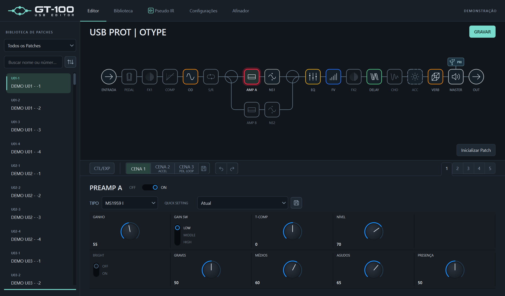

# GT-100 USB Editor

**Português (Brasil)** · [English](README.en.md)

GT-100 USB Editor é um projeto que visa lutar contra a obsolescência, atualizando a experiência de uso desta pedaleira com quase 15 anos de idade. Uma interface mais moderna e adições de qualidade de vida como cópia de presets, atalhos de Assign nos knobs, configuração automática de Assigns com base em cenas e a tecnologia de **Pseudo IR**: uma ferramenta que usa IRs de gabinetes de guitarra como referência para aproximar sua resposta de frequência usando apenas os blocos internos da GT-100.

**[Baixar a alpha para Windows](https://github.com/gabrielrc99/gt100-usb-editor/releases/tag/v0.1.3-alpha.1)** · **[Conhecer os recursos em detalhes](docs/FEATURES.md)**

## Download e primeiros passos

**0.1.3 Alpha 1**, para **Windows 64 bits**, disponível como [pré-lançamento](https://github.com/gabrielrc99/gt100-usb-editor/releases/tag/v0.1.3-alpha.1). Esta é a edição de distribuição para usuário final. A versão alpha ainda está em testes.

- **Instalador (.exe):** instalação por usuário, com atalhos e desinstalação.
- **Portátil (.zip):** extraia o pacote e abra `GT100-USB-Editor-Portable.exe`. Preserve a pasta `GT100-data` ao mover ou atualizar o programa.

Instale o [driver USB BOSS compatível com a GT-100 e seu Windows](https://www.boss.info/us/support/by_product/gt-100/), conecte a pedaleira por USB e abra o editor. **Não é necessário instalar Python ou o Tone Studio.**

## Features adicionados

- **Visual modernizado**, com cadeia de efeitos interativa, reorganização de blocos e controles vetoriais.
- **Suporte a português do Brasil**, além do inglês, com seleção de idioma pela interface.
- **Atalhos de Assign** nos knobs e switches compatíveis.
- **Cenas com atribuição automática de Assigns**, usando os recursos da própria GT-100.
- **Pseudo IR**, com busca de gabinete e ajuste de EQ para aproximar um IR tradicional, biblioteca local e comparação por áudio.
- **Cópia de presets e configurações de efeitos**, com backup do destino antes de sobrescrevê-lo.
- **Desfazer e refazer edições**, com histórico de alterações do patch atual.

O Pseudo IR aproxima a resposta de frequência com os gabinetes e EQs internos; a GT-100 não carrega o arquivo WAV nem passa a executar convolução. Veja o [guia de recursos](docs/FEATURES.md#pseudo-ir) para entender as versões e limitações.

As edições afetam o patch temporário. Use **Salvar…** para gravar na memória da pedaleira; o editor faz backup do destino antes de sobrescrevê-lo.

## Features planejados

- Expansão de cenas para pedais externos e numérico.

## Licença

O GT-100 USB Editor é distribuído sob a [licença MIT](LICENSE). As dependências mantêm suas próprias licenças e avisos, incluídos nos pacotes.

Nesta alpha, estão disponíveis os compilados para Windows; a publicação dos fontes está prevista para uma próxima etapa.

## Agradecimentos

Um grande obrigado ao **[GT-100 Fx FloorBoard](https://fxfloorboard.sourceforge.io/info.php?model=gt-100)**, que serviu de referência para a criação deste projeto.

---

Os **compilados para Windows** estão na [release alpha](https://github.com/gabrielrc99/gt100-usb-editor/releases/tag/v0.1.3-alpha.1), com instalador e versão portátil. Projeto independente, sem afiliação à BOSS/Roland.
