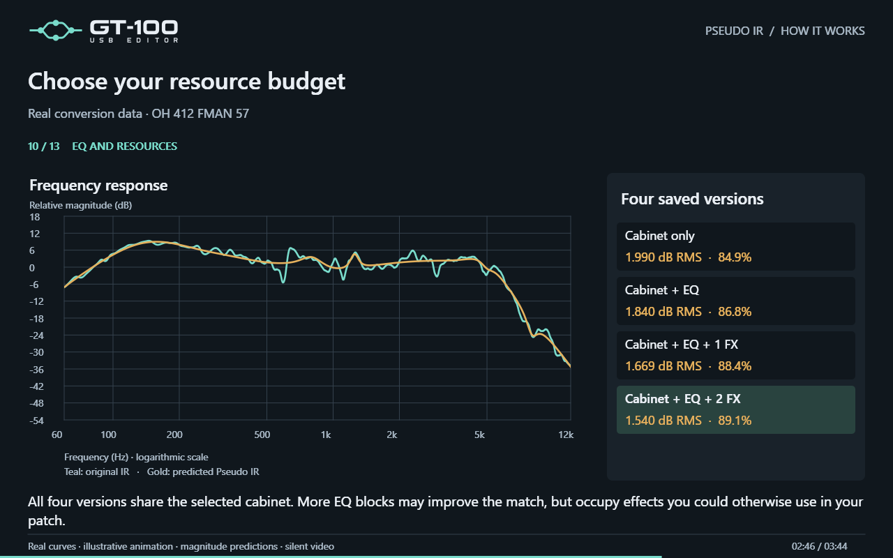

# How Pseudo IR works

[← Features](../../FEATURES.en.md#pseudo-ir)

**English · 3 minutes 44 seconds · silent visual explainer**

[Watch or download the MP4](how-it-works.mp4) · [English captions](captions.en.vtt)

The video follows the conversion of **OH 412 FMAN 57**, using actual saved frequency curves, settings and scores. Curve reveals and the sequence of results are explanatory animation, rather than a screen recording of solver iterations. There is no voice-over or audio demonstration. The IR WAV, guitar samples, hardware recordings and application source are not included.

## Chapters and transcript

| Time | Topic |
| --- | --- |
| 00:00 | A cabinet IR supplies a target frequency response. Pseudo IR finds cabinet and EQ settings that the GT-100 can run on its own. The WAV stays on the computer. |
| 00:12 | The fixed library contains **7 cabinets × 5 microphones × 2 axes × 11 positions = 770 measured configurations**. Each complete combination is scored after compensating volume on the same valid frequency grid. |
| 00:28 | **CUSTOM** adds speaker size, speaker count and cabinet type. Low and High Color offer **441 pairs per CUSTOM base** through an experimental magnitude model. These predicted responses are not individual hardware recordings. CUSTOM is included by default; Nerd Mode can restrict the search. |
| 00:44 | **Expanded Color + EQ search** refines three leading candidates, retaining the best fixed option if needed. CUSTOM is tried with preselected and neutral Color starting points; Color and EQ can alternate for up to two rounds per starting point. The lowest full-band RMS with **EQ + 2 FX** selects one cabinet base for all four versions. This is a bounded search without a global optimum guarantee. |
| 01:04 | Two fitting strategies are compared: **80 Hz–6 kHz**, with a soft preference for that range, and **200 Hz–5 kHz**, restricting active parametric mid-band centers to the focus range. Shelves, cuts and graphic bands remain available. **Auto** chooses the lower RMS over the common full band at each level, rather than comparing scores with different frequency weights. Nerd Mode can select either strategy manually. |
| 01:24 | The **dedicated EQ** uses shelves, two parametric mid bands and low/high cuts. Settings stay within the values supported by the GT-100. |
| 01:40 | With **one FX**, the search compares parametric and graphic EQ; you choose physical FX1 or FX2 when applying. With **two FX**, it compares P + P, P + G and G + P. The dedicated EQ remains parametric, and at most one graphic EQ is used. All active blocks can be readjusted together. |
| 01:56 | Mixed chains test **P > G > P**, **P > P > G** and **G > P > P**. The order favors lower predicted intermediate gain. In this example, **EQ > FX2 > FX1** has a predicted intermediate peak of **6.65 dB**, versus **8.78 dB** in the other mixed orders. This does not guarantee physical equivalence or clipping-free operation. |
| 02:14 | **Nerd Mode** can show each EQ's contribution independently, including LEVEL. Zero dB means no change; positive values boost and negative values cut. Volume compensation is a spectral estimate, rather than a loudness measurement. |
| 02:30 | Choose **cabinet only**, **cabinet + EQ**, **cabinet + EQ + 1 FX**, or **cabinet + EQ + 2 FX**. More EQ blocks may improve the match but occupy resources otherwise available for effects. |
| 02:50 | Connect the GT-100, select an enabled **Preamp A or B**, and use **Prepare preview**. Open Chords, Power Chords and Melody are prepared in sequence, reusing valid cached results. The patch is restored before listening is enabled. The original reference convolves the recorded preamp without a cabinet with the IR; alternatives use recordings through the GT-100 cabinet and EQ blocks. Playback supports switching versions, pause, loop and output-device selection. |
| 03:10 | **RMS** measures spectral error; lower is better. **Proximity** measures volume-aligned spectral shape; higher is closer. Neither measures perceptual fidelity. Nerd Mode's **waveform null test** is a separate phase-sensitive audio diagnostic after integer-delay, polarity and gain alignment. It does not rank candidates or optimize the patch. |
| 03:28 | Choose the version, destination preamp and FX block where applicable. **Apply** updates the temporary patch and places the used EQs after that preamp. Other effects remain available. Use **WRITE** to save the result in the GT-100. |

## Results shown

All four versions below use the selected **CUSTOM 9″ ×4 CLOSE · Color L +4 / H +10**, CND451, on axis, 1 cm from the center. Values are predictions from the magnitude model on the shared valid frequency grid within 60 Hz–12 kHz, rounded for display.

| Version | RMS | Spectral proximity |
| --- | ---: | ---: |
| Cabinet only | 1.990 dB | 84.9% |
| Cabinet + EQ | 1.840 dB | 86.8% |
| Cabinet + EQ + 1 FX | 1.669 dB | 88.4% |
| Cabinet + EQ + 2 FX | 1.540 dB | 89.1% |

The expanded search tested seven refinement results across four base candidates. Its best full-band RMS was **1.540 dB**, compared with **1.607 dB** for its initial best-cabinet refinement. This comparison concerns predicted magnitude error; it does not establish an audible improvement or a new physical validation.

Proximity is `100 × mean(10^(−abs(volume-aligned error in dB)/20))` on the conversion's valid log-frequency grid. It is independent of the waveform null test, which also responds to phase and timing differences.

The GT-100 uses its built-in cabinets and EQs. It does not load the IR file or reproduce its phase and time response. Check the result with your guitar and output system before saving.
